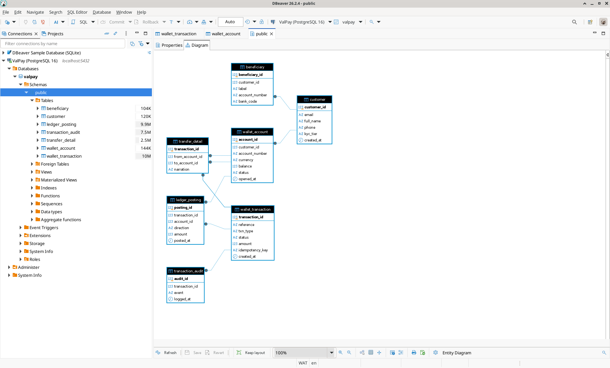
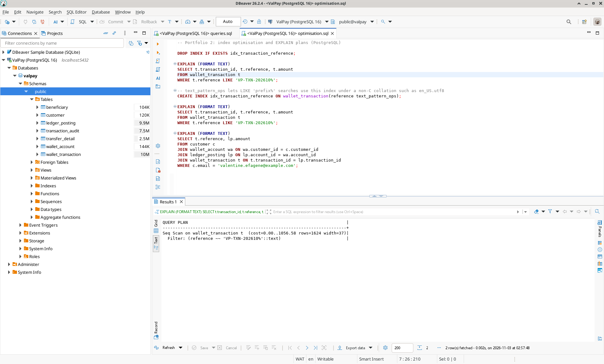
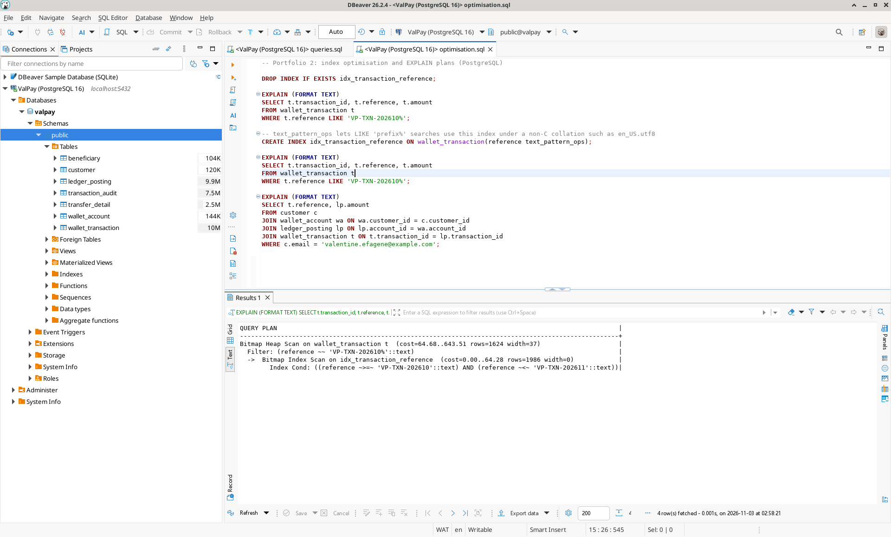
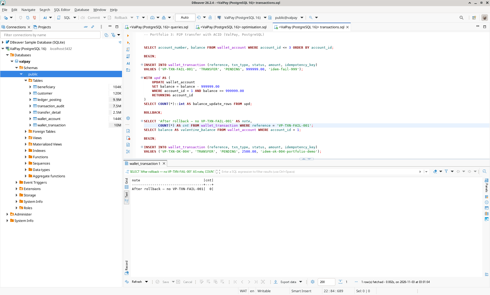
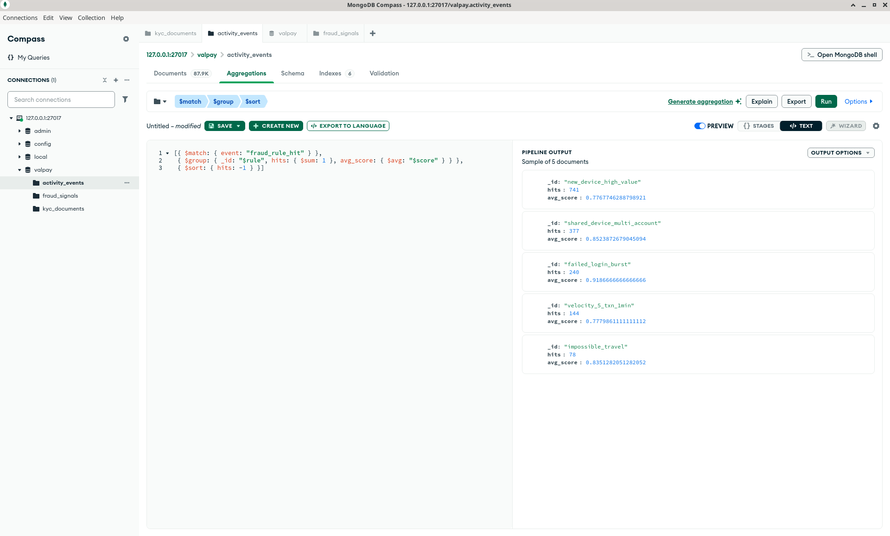
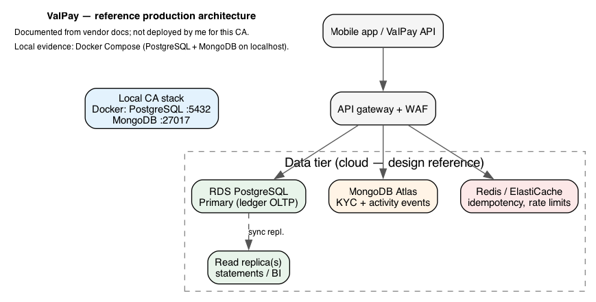

::: {.cover-sheet}
Full Name: Valentine Efagene

Miva Email Address: v.efagene1385@miva.edu.ng

MIVA ID: 301921385

Course: MIT 8103 – Advanced Database Systems

Assessment: Continuous Assessment — September cohort 2026; ValPay case study; Portfolios 1–5 and final documentation

Organisation / case study: ValPay — mobile wallet and P2P payments (fintech). Full scenario: [Efagene_Valentine_301921385_CASE_STUDY.md](./Efagene_Valentine_301921385_CASE_STUDY.md).
:::

## 1. GITHUB REPOSITORY AND SUBMISSION

Public submission repository (source, SQL/Mongo scripts, evidence, and this document):

**https://github.com/Valentine-Efagene/advanced-database-portfolio**

Assessors can clone or browse the tree without access requests. I regenerate relational evidence with:

`./scripts/Efagene_Valentine_301921385_InitAndEvidence.sh`

Submit to the LMS as **Efagene_Valentine_301921385_DOCUMENTATION.pdf** inside the assessment zip alongside the README and portfolio folders.

## 2. SELECTED ORGANISATION

I chose **ValPay**, a Nigerian fintech platform offering NGN wallets, peer-to-peer transfers, top-ups, and auditable transaction history. Retail customers move money; compliance, finance, and support staff need traceability by reference, ledger integrity, and KYC status. Core data includes customers, wallet accounts, double-entry ledger postings, transfer metadata, beneficiaries, and audit events. I documented the scenario in `Efagene_Valentine_301921385_CASE_STUDY.md` and reused it across Portfolios 1–5.

## 3. SUMMARY OF ALL FIVE PORTFOLIOS

### Portfolio 1 — Database design and modelling

I modelled ValPay relationally: customers, `wallet_account`, `wallet_transaction`, `ledger_posting`, `transfer_detail`, beneficiaries, and `transaction_audit`. My ER diagram captures one-to-many wallet and transaction relationships and the ledger’s dependence on accounts. The physical schema enforces non-negative balances, unique transfer references, idempotency keys, and no self-transfers. In `Efagene_Valentine_301921385_P1_NORMALIZATION.md` I argued for 1NF–3NF: atomic amounts, customer attributes on `customer` only, and running balance on `wallet_account` updated through controlled transactions rather than duplicated on unrelated tables. This schema is the foundation for the transfer and query work in Portfolios 2–3.

### Portfolio 2 — Query processing and optimisation

I wrote six reporting and operational queries: statements, daily volume, reference lookup, low-balance alerts, failed/pending queues, and ledger reconciliation. When I ran `EXPLAIN (ANALYZE, BUFFERS)`, **Q3** (filter by transfer `reference` prefix) used a sequential scan on `wallet_transaction`. After I added `idx_transaction_reference`, the plan moved to a **bitmap index scan**—the behaviour I would expect when support traces `VP-TXN-*` references. Q1 already used `idx_ledger_account` on the statement join path. I saved results and plans under `portfolio-2-query-optimisation/evidence/`.

### Portfolio 3 — Transactions and concurrency

I implemented P2P transfer logic in a single PostgreSQL transaction: balance check, transaction insert, paired ledger postings, and audit append. In **Test A** I attempted a debit larger than the available balance; the debit `UPDATE` affected zero rows, I issued **ROLLBACK**, and no row remained for the failed reference—balances unchanged. In **Test B** I committed a 2,500 NGN transfer with balanced debits/credits and updated balances. I did not load-test concurrent sessions locally; I note in the README that production ValPay would add `SELECT … FOR UPDATE` on wallet rows under concurrent API traffic.

### Portfolio 4 — NoSQL and advanced data models

I stored semi-structured **KYC documents**, **activity events**, and **fraud signals** in MongoDB while keeping the ledger in PostgreSQL (see `Efagene_Valentine_301921385_P4_SUITABILITY.md`). I applied JSON Schema validation so invalid enum values are rejected; I built compound indexes for pending KYC queues and time-window activity traces. Aggregation pipelines let me summarise fraud rule hits by device and customer. I linked documents to the relational core via `customer_id` and transaction `reference` without copying ledger amounts into MongoDB.

### Portfolio 5 — Distributed and cloud database exercise

I produced a **reference production architecture** for ValPay (RDS PostgreSQL Multi-AZ, read replicas, MongoDB Atlas, Redis/ElastiCache) based on vendor documentation and course material—not on infrastructure I personally provisioned for this assessment. What I **did run and verify locally** is the Docker Compose stack in `Efagene_Valentine_301921385_P5_DockerCompose.yml` (PostgreSQL + MongoDB on localhost), which backs my evidence for Portfolios 1–4. In the write-up I relate CAP trade-offs (strong consistency for ledger writes; looser consistency acceptable for some analytics reads), outline a sharding path for `activity_events`, and note NDPA-oriented retention ideas. Connection details are in `portfolio-5-distributed-cloud/evidence/Efagene_Valentine_301921385_P5_ConnectionNotes.txt`.

## 4. SELECTED EVIDENCE (SCREENSHOTS)

The figures below are outputs I captured from my local runs. Full text logs and additional screenshots are in each portfolio’s `evidence/` folder and in the per-portfolio evidence PDFs in the submission zip.

*Figure 1: Entity–relationship model (Portfolio 1)*

*Figure 2: Query plan before index (Portfolio 2, Q3)*

*Figure 3: Query plan after index (Portfolio 2, Q3)*

*Figure 4: Failed transfer rollback (Portfolio 3)*

*Figure 5: Fraud aggregation in MongoDB (Portfolio 4)*

*Figure 6: Reference cloud layout and local stack (Portfolio 5)*

## 5. INDIVIDUAL REFLECTION

**Design choices I made**

I kept **wallet balances and ledger postings in PostgreSQL** because I needed ACID guarantees and reconcilable double-entry rules for ValPay. I pushed variable KYC payloads, high-volume activity, and fraud analytics to MongoDB where flexible schema and event-style storage fit better. I used surrogate keys plus unique business references (`reference`, `idempotency_key`) to reflect how payment APIs prevent duplicate debits. Storing `balance` on `wallet_account` was a deliberate read optimisation, but I only update it inside my Portfolio 3 transfer transaction so it does not drift from the ledger.

**Challenges I faced**

1. **Normalisation versus query speed** — I wanted fast balance reads without breaking 3NF logic. I accepted a controlled denormalised balance field and forced every change through my transactional transfer script, documenting that rule so future changes do not bypass it.

2. **Making Q3 fast enough** — I initially misread whether a prefix filter on `reference` would use a B-tree index. I had to run `EXPLAIN` several times before I trusted the bitmap index plan; saving before/after screenshots helped me prove the improvement to myself and to assessors.

3. **Linking two stores without two ledgers** — I had to resist putting monetary amounts into MongoDB. I stuck to `customer_id` and `reference` as join keys and kept all debits and credits in PostgreSQL.

4. **Reproducible evidence on my Mac** — I hit port and credential mismatches until I centralised startup in one init script and Docker Compose. That was tedious, but now I can regenerate the whole evidence bundle in one command.

5. **Honest scope for cloud HA** — I could not justify the cost of standing up Multi-AZ RDS and Atlas for a coursework zip. I separated what I **validated locally** (Docker Postgres/Mongo, scripts, screenshots) from what I **researched and diagrammed** as a production target, and I state that clearly so my submission is not overstated.

**What I learned**

I learned that polyglot persistence works when I draw a hard line: strong consistency for money, eventual consistency only where the business accepts lag. ER modelling, index tuning, and transaction scripts reinforce each other—I should not treat them as isolated portfolio tasks. Finally, automating evidence generation saved me from silent regressions before I zipped the project for the LMS.

## 6. REFERENCES

- Federal Republic of Nigeria. (2023). *Nigeria Data Protection Act 2023* (Act No. 7 of 2023). National Assembly of the Federal Republic of Nigeria. https://nass.gov.ng (retrieved 13 November 2026).

- Amazon Web Services, Inc. (2026). *Amazon RDS for PostgreSQL*. https://docs.aws.amazon.com/AmazonRDS/latest/UserGuide/ (retrieved 13 November 2026).

- MongoDB, Inc. (2026). *MongoDB Atlas documentation*. https://www.mongodb.com/docs/atlas/ (retrieved 13 November 2026).

- Miva Open University. (2026). *MIT 8103 Advanced Database Systems — continuous assessment brief* (September cohort). Learning management system course materials.

- PostgreSQL Global Development Group. (2026). *PostgreSQL 16 documentation*. https://www.postgresql.org/docs/16/ (retrieved 13 November 2026).

- Silberschatz, A., Korth, H. F., & Sudarshan, S. (2020). *Database system concepts* (7th ed.). McGraw-Hill.

## 7. AI USE DECLARATION

I used **Cursor AI** to scaffold folders, suggest SQL/Mongo patterns, render the Portfolio 5 architecture diagram from my DOT source, and polish documentation prose. I made the ValPay design decisions, ran `./scripts/Efagene_Valentine_301921385_InitAndEvidence.sh`, and personally verified balances, rollback behaviour, `EXPLAIN` output, and Mongo query results on my local databases. I reviewed and corrected any wording that implied cloud resources I had not deployed. I am responsible for the accuracy of everything in the repository and submission zip.
